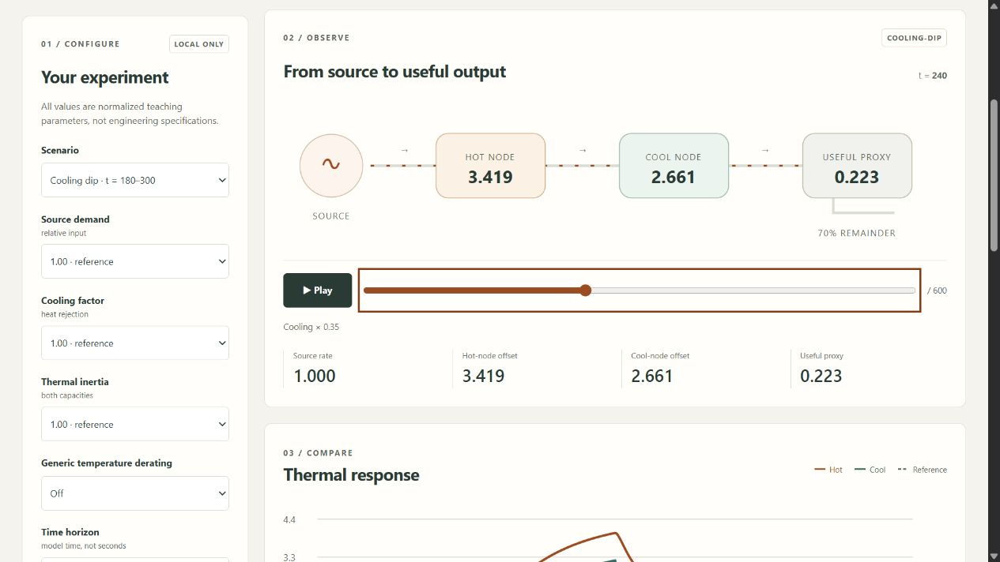

# Reactor Systems Simulator

[](https://github.com/JasonStys/reactor-systems-simulator/actions/workflows/validate.yml)
[](https://github.com/JasonStys/reactor-systems-simulator/actions/workflows/codeql.yml)

A local, interactive **fictional thermal-system learning workbench** by [Jason Stys](https://github.com/JasonStys). C++ computes an energy-conserving two-node analogy; TypeScript visualizes it; Python serves the app and produces auditable reports. SQL supports optional local immutable experiment history.

Despite its nuclear-energy learning context and name, this is **not reactor physics**. It cannot design, predict, monitor, control or assess the safety of any real reactor. All coefficients, inputs, time and outputs are invented and dimensionless. It has no fuel/rod selection, neutron kinetics, criticality, radiation/dose, decay heat or real telemetry. Source-off is not a nuclear shutdown/SCRAM model. See [model boundary](docs/MODEL.md).



## Explore

- Four synthetic experiments: constant source, demand step, temporary cooling dip, and source input removed.
- Bounded source demand, cooling factor, thermal inertia and generic temperature derating—not nuclear reactivity feedback.
- An animated energy network, experiment/reference temperature curves, keyboard timeline, playback, readable data table and energy ledger.
- JSON, CSV and inert HTML reports containing full samples, assumptions, numeric residuals, settings and a SHA-256 identity.
- Optional CLI-only SQLite history: parameterized inserts, content verification, no updates/deletes, 100-run cap.
- Loopback-only service; no accounts, uploads, cloud APIs, analytics or external assets. Mobile-responsive browser UI.

## Run the app

Download the matching portable ZIP and its SHA-256 file from [Releases](https://github.com/JasonStys/reactor-systems-simulator/releases). Verify the checksum, extract **the entire ZIP**, then launch `ReactorSystemsSimulator.exe` (Windows) or `ReactorSystemsSimulator` (Linux/macOS). A local browser window opens; closing its console stops the service. No compiler, Node, Python setup, admin rights or real reactor data is needed for packaged apps.

The bundles are **unsigned**, not notarized or store-certified. Do not disable OS protections or bypass warnings; build reviewed source if your OS blocks the bundle. Builds target the architecture listed on each asset, not every architecture. Mobile uses a compatible browser connected to its own local runtime; no native Android/iOS package or public hosting is provided. The server deliberately does not expose a LAN/public address.

## Build reviewed source

Requires Python 3.12–3.14, Node 24 and a C++20 toolchain (Visual Studio 2022/2026 C++ tools on Windows, GCC/Clang on Linux, Xcode command-line tools on macOS). Commands run from this repository root:

```text
python -m venv .venv
# Activate .venv with your platform's standard command.
python -m pip install --require-hashes -r requirements-dev.lock
python tools/build_native.py
npm ci
npm run build
python -m simulator serve
```

The service prints an ephemeral `http://127.0.0.1:<port>/` URL. For a fixed local port: `python -m simulator serve --port 8775 --no-browser`. The bundled application is a local web application, not an embedded webview with extra native privileges.

```text
python -m simulator export --scenario cooling-dip --cooling 0.5 --duration 300 --output evidence.json
python -m simulator export --scenario source-off --format csv --output samples.csv --history history.sqlite3
```

Exports refuse to overwrite existing files. History and file export are separate transactions. Paths and database files are never accepted through HTTP.

## Verify

```text
python tools/build_native.py
python -m pytest --cov=simulator --cov-report=term-missing
python -m ruff check simulator tests tools launcher.py
python -m ruff format --check simulator tests tools launcher.py
python -m mypy simulator
python tools/verify_repo.py
npm run format:check
npm test
npm run build
npx playwright install chromium firefox webkit
npm run test:e2e
python -m pip_audit --disable-pip --no-deps -r requirements-dev.lock
npm run audit
python tools/package_app.py
```

Linux also runs Clang AddressSanitizer/UndefinedBehaviorSanitizer and GCC coverage. [Validation evidence](docs/VALIDATION.md) distinguishes numerical verification from physical validation. CI gates Python branch/line coverage at 90% and production C++ line coverage at 90%; it does not hide exclusions. Actions uploads no run artifacts or caches. Release ZIPs go directly to draft GitHub Releases after successful exact-commit checks.

## Project map

| Area                                            | Responsibility                                                                                      |
| ----------------------------------------------- | --------------------------------------------------------------------------------------------------- |
| `native/model.hpp`, `model.cpp`                 | Fictional coefficients/contracts, bounded inputs, source relaxation and conservative heat balance   |
| `native/cli.cpp`, `tests.cpp`                   | Fixed numeric JSON worker and Release-active native regression tests                                |
| `simulator/engine.py`                           | Reviewed settings, worker isolation/validation, detached cache, provenance and content IDs          |
| `simulator/server.py`                           | Read-only loopback HTTP, origin/Host checks, asset confinement and restrictive headers              |
| `simulator/reports.py`, `resources/history.sql` | JSON/CSV/HTML evidence and explicit local immutable history                                         |
| `simulator/__main__.py`, `launcher.py`          | Source/portable startup and no-overwrite CLI exports                                                |
| `web/`                                          | Responsive accessible interface, SVG plots/network, finite preferences and stale-request protection |
| `tests/`                                        | Independent reference, property, security, integration, display and cross-engine browser tests      |
| `tools/`                                        | Native build, generated exact-line inventories, packaging, frozen-app smoke and gated release tools |
| `.github/workflows/`                            | Cross-platform tests/packages, native sanitizers/coverage, CodeQL and manual draft releases         |

Every file is summarized in [FILE_CATALOG](docs/FILE_CATALOG.md). Code headers describe file responsibilities; function/class contracts explain inputs and state. [CODE_INDEX](docs/CODE_INDEX.md) is the CI-checked exact line map for functions, parameters, variables and structural identifiers, avoiding stale duplicated line numbers in headers.

## Documentation and contact

[User guide](docs/USER_GUIDE.md) · [Model & assumptions](docs/MODEL.md) · [Architecture / ADR](docs/ARCHITECTURE.md) · [API](docs/API.md) · [Security](docs/SECURITY.md) · [Validation](docs/VALIDATION.md) · [Release guide](docs/RELEASE.md) · [Dependencies](docs/THIRD_PARTY.md)

Created by **Jason Stys**. [Portfolio/contact profile](https://github.com/JasonStys) · [Issues](https://github.com/JasonStys/reactor-systems-simulator/issues). MIT licensed; no certification, regulatory approval or suitability for nuclear operations is implied.
